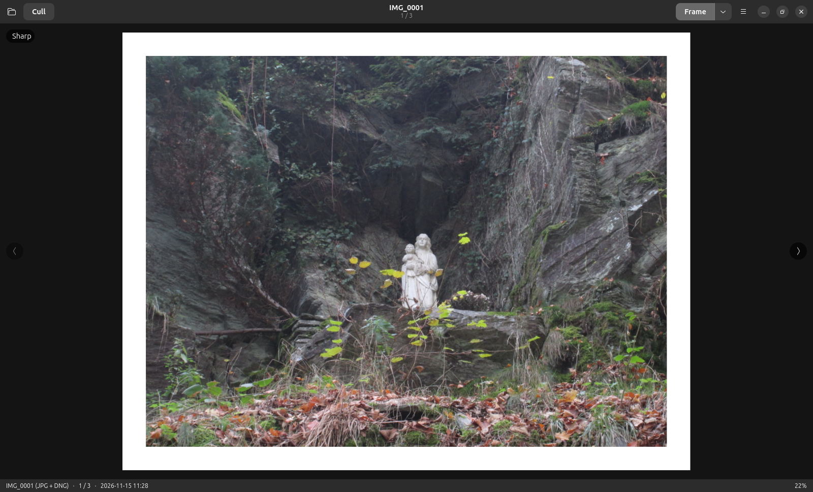
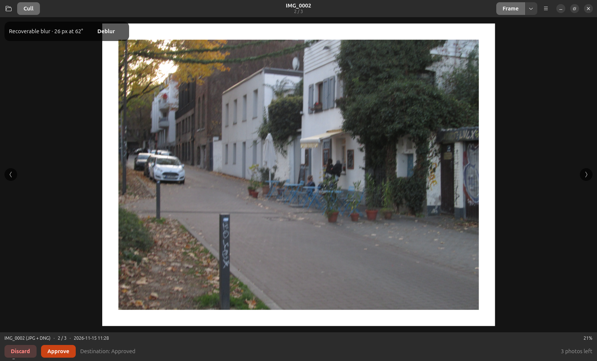
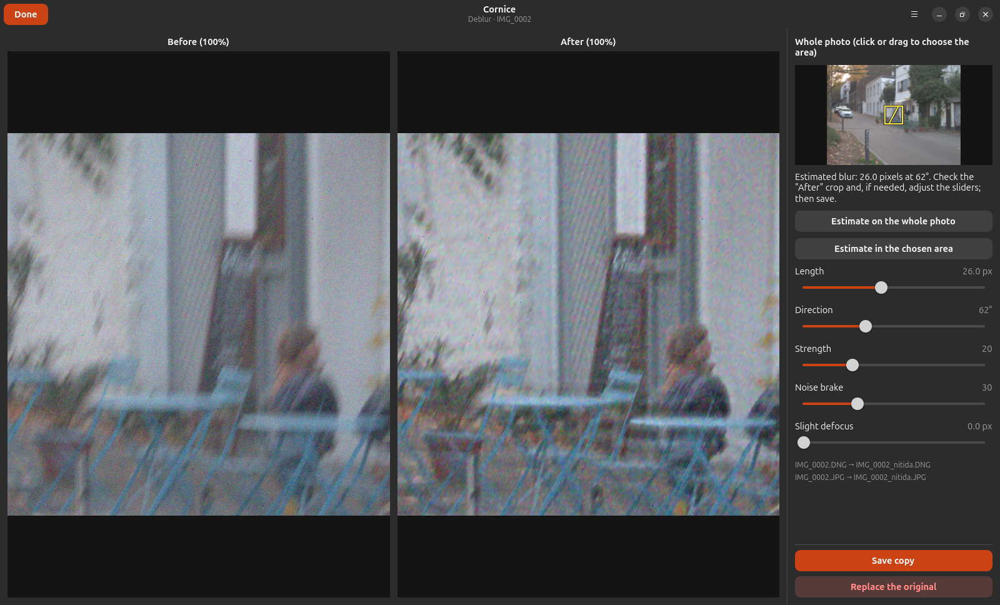

# Cornice

A photo viewer for Linux (GNOME) that I wanted for myself, written in Python with GTK 4 and libadwaita.

- **Viewer** with an optional white frame (handy to judge a photo on screen the way a print would look),
  smooth zoom, 100 % view, full screen. JPG, PNG, TIFF, WebP and RAW files (HEIC/HEIF too, if
  `pillow-heif` is installed). A JPG and its RAW with the same name count as one shot.
- **Culling.** Go through a folder and either *discard* a shot (it goes to the trash) or *approve* it (it is
  moved to a folder of your choice). Approving copies the files, compares them byte by byte and only then
  deletes the originals; nothing is ever overwritten. **Ctrl+Z** undoes the last actions.
- **Blur indicator.** In the background Cornice estimates camera shake and tells you "Sharp",
  "Recoverable blur · 25 px at 64°" or "Uncertain blur".
- **Deblur.** A built-in mode that removes straight-line motion blur. For RAW files it works on the sensor
  data, before colour reconstruction, and writes a **real DNG** that you can develop in darktable,
  Lightroom or any other raw developer. It can save a copy or replace the original (the original goes to the
  trash, and Ctrl+Z brings it back).
- Interface in **English and Italian** (it follows your system language).

## Screenshots

**Viewer with the white frame**, and the blur indicator in the corner:



**Culling** (Discard / Approve at the bottom). This shot is blurred, and Cornice offers to fix it:



**Deblur**: the same photo at 100 %, before and after. The RAW is corrected on the sensor data and saved as a DNG:



## Install

Tested on Ubuntu 26.04 (GNOME). It should work on any recent Debian/Ubuntu-based distribution with GTK 4.14+
and libadwaita 1.5+.

```sh
git clone https://github.com/GioVatti/cornice.git
cd cornice
./install.sh
```

`install.sh` asks for your password once if system packages are missing (`python3-gi`, `gir1.2-gtk-4.0`,
`gir1.2-adw-1`, `python3-numpy`, `python3-pil`). Then:

- it installs **rawpy** (the RAW decoder, not packaged by Ubuntu) into a private virtual environment in
  `~/.local/share/cornice/venv` (this needs an internet connection once); without it Cornice still works, but RAW
  files show only the preview embedded in them and cannot be deblurred;
- it adds a menu entry ("Cornice"), the "Open With" association and an icon under `~/.local/share`.

Nothing else is copied: the menu entry starts Cornice from the folder you cloned, so `git pull` updates it.
You can also just run `python3 cornice.py` from that folder. For HEIC/HEIF files install `pillow-heif`
(`pip install pillow-heif` in the venv above); it is optional.

Uninstall: `./uninstall.sh` (it asks before deleting your settings; your photos are never touched).

The first time you start Cornice it asks where approved photos should go (the proposal is
`Pictures/Approved`; the folder is only created when you approve the first photo).

## Usage

```sh
cornice.py [PHOTO or FOLDER ...]     # or "Open With > Cornice" in the file manager; --help, --version
```

| Key | Action |
|---|---|
| Left / Right, Page Up / Page Down, Home / End | previous / next / first / last photo |
| Mouse wheel, `+` `-` | zoom; `0` fit to window, `1` actual size (100 %), double click toggles |
| `C` | white frame (thickness slider next to the button) |
| `F` / F11, Esc | full screen / leave it |
| `X` / Del | discard to the trash (only in culling mode) |
| `A` / Enter | approve, move to the destination folder (only in culling mode) |
| `M` | Deblur mode on the current photo (Esc or "Done" leaves it) |
| Ctrl+Z | undo the last discard / approve / replace |
| Ctrl+O, Ctrl+, | open a folder, preferences |

Click **Cull** in the header bar to show the Discard / Approve buttons. The destination folder is set in
Preferences.

### Deblur

Open it with the **Deblur** button next to the blur indicator, or with `M` on any photo. You get two crops
side by side at true 100 %, *Before* and *After*, a map of the whole photo (click or drag to choose the crop),
and sliders for the length and direction of the blur, the strength, a noise brake and a slight-defocus
correction. Cornice starts from its own estimate; you refine it by eye. Then **Save copy** writes
`<name>_nitida` next to the original (`_nitida` is Italian for "sharp"), or **Replace the original** swaps it in
(the original goes to the trash).

## How the deblur works

1. The blur length and direction are estimated from the *cepstrum* of the image (a straight-line motion blur
   leaves a negative peak at the blur vector), on the whole photo and on nine zones that vote.
2. The blur is modelled as a straight line (a point spread function) and removed with Richardson–Lucy
   deconvolution, a few iterations per colour channel, in linear light.
3. A total-variation regularisation (the "noise brake") keeps noise and fine textures from blowing up
   without softening sharp edges.
4. For RAW files the four Bayer colour planes are deconvolved separately, at half the blur length, before
   demosaicing; blown highlights are left alone. The result is written as an uncompressed 16-bit DNG
   (or, for CHDK DNGs, the original file with the pixels replaced).
5. The preview only processes the visible crop (plus a margin), in a background thread; saving processes the
   whole photo.

## Limits

- It removes **straight-line** motion blur (a shake or a push on the shutter button) of about **6 pixels or more**.
  It does not fix out-of-focus photos (apart from a slight uniform defocus slider), rotation blur, or a moving
  subject on a sharp background (use "Estimate in the chosen area" for that, with luck).
- RAW files whose sensor is not a Bayer one, such as the Fujifilm X-Trans cameras, **cannot be deblurred**;
  you can still view them and cull them, and the JPG of the pair can be deblurred.
- Very large photos (above 6500 px on the long side) are estimated on a reduced copy; the slider range grows
  with the resolution.
- Linux with GNOME only (GTK 4 and libadwaita). Tested on Ubuntu 26.04.
- Deblurring a JPG saves a new JPEG (quality 95), so it loses a little quality.

## Translations

English is the source language; the Italian translation is in `po/it.po`. To add another language see
[DEVELOPMENT.md](DEVELOPMENT.md).

## License

GPL-3.0-or-later, see [LICENSE](LICENSE).

Developed by Giovanni Vatti with the help of Claude (Anthropic).
